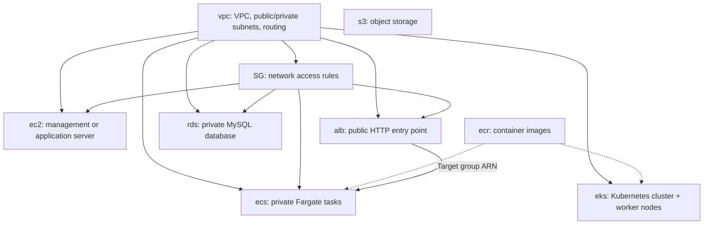

# Reusable AWS Terraform Modules

A collection of reusable Terraform modules for building AWS infrastructure without rewriting the same resources for every project. Each folder represents a separate module with a specific responsibility. A **root Terraform configuration** calls the modules, supplies environment-specific values, and connects their outputs to other modules.

These are **module definitions**, not a record of which resources are currently deployed in AWS.

## Module overview

| Module | Purpose | Main AWS resources |
| --- | --- | --- |
| [`vpc/`](#vpc--networking) | Create the network used by application and infrastructure resources | VPC, subnets, internet gateway, NAT gateways, route tables |
| [`SG/`](#sg--security-groups) | Control inbound and outbound network traffic | Security group and configurable rules |
| [`ec2/`](#ec2--virtual-machine) | Launch a configurable EC2 instance | EC2 instance; optional IAM instance profile attachment |
| [`ecr/`](#ecr--container-image-registry) | Store and manage Docker/container images | ECR repository and lifecycle policy |
| [`eks/`](#eks--managed-kubernetes) | Run container workloads on managed Kubernetes | EKS cluster, node group, IAM roles, EKS add-ons, CloudWatch log group |
| [`alb/`](#alb--application-load-balancer) | Distribute HTTP traffic to application targets | Application Load Balancer, IP target group, HTTP listener |
| [`ecs/`](#ecs--fargate-container-service) | Run containerized applications with ECS on Fargate | ECS cluster, task definition, service, IAM roles, CloudWatch log group |
| [`rds/`](#rds--mysql-database) | Provide a private managed MySQL database | RDS MySQL instance and DB subnet group |
| [`s3/`](#s3--object-storage) | Provide a private, versioned object storage bucket | S3 bucket and security/versioning configuration |

## How the modules fit together

The network module provides subnet IDs and the VPC ID to other modules. The security group module creates network access rules for those resources. Compute modules use those network settings to launch workloads.



*The diagram shows possible relationships, not a single mandatory deployment. For example, the `alb/` module is designed for direct HTTP forwarding to IP targets and can be connected to the `ecs/` module. The EKS module does not automatically create this ALB; an EKS load balancer controller can manage separate load balancers through Kubernetes resources.*

## Module details

### `vpc/` — Networking

**Purpose:** Build the base network where AWS resources are deployed.

**What it sets up:**
- One VPC with DNS support and hostnames enabled.
- Two public subnets and two private subnets across two Availability Zones.
- One internet gateway and a public route table for internet access.
- Two NAT gateways, each with an Elastic IP, and separate private route tables for outbound access from private subnets.
- Public/private subnet tags used for Kubernetes load balancer discovery.

**Main configuration:** `name`, `vpc_cidr` (default `10.0.0.0/16`), optional `availability_zones`, optional subnet CIDRs, `subnet_newbits` (default `8`), and `tags`. When subnet CIDRs and AZs are not supplied, the module calculates/selects them.

**Useful outputs:** `vpc_id`, `vpc_cidr`, `public_subnet_ids`, `private_subnet_ids`, `availability_zones`, `nat_gateway_ids`.

**Why it matters:** Other modules reuse the same network rather than creating separate, disconnected VPCs. Two NAT gateways provide an outbound route for private subnets in each configured AZ; NAT gateways also incur charges.

### `SG/` — Security Groups

**Purpose:** Reuse the same security group logic for different AWS resources by passing different rules.

**What it sets up:** One VPC security group with dynamic inbound (`ingress_rules`) and outbound (`egress_rules`) rules. Rules can allow traffic from CIDR blocks or other security groups.

**Main configuration:** `name`, `vpc_id`, optional `description`, `ingress_rules`, `egress_rules`, and `tags`.

**Defaults:** No inbound rules; outbound IPv4 traffic is allowed to `0.0.0.0/0` unless custom egress rules are supplied.

**Useful outputs:** `security_group_id`, `security_group_name`.

**Why it matters:** The same module can create separate security groups for an EC2 management server, ALB, ECS tasks, or database. The calling configuration decides which ports and sources are allowed.

### `ec2/` — Virtual Machine

**Purpose:** Launch a configurable EC2 instance, such as a management or administrative server.

**What it sets up:** One EC2 instance in a selected subnet, attached to supplied security groups and optionally an existing IAM instance profile and EC2 key pair.

**Main configuration:** `name`, `subnet_id`, `security_group_ids`, `instance_type` (default `t3.micro`), optional `ami_id`, `key_name`, `iam_instance_profile_name`, `associate_public_ip_address`, and `tags`.

**Defaults:** If `ami_id` is omitted, the module finds a recent **Ubuntu Server 24.04 LTS x86_64** AMI. Public IP assignment defaults to `true`.

**Useful outputs:** `instance_id`, `instance_public_ip`.

**Why it matters:** Instance sizing, network placement, image, and access can be changed without rewriting the EC2 resource. This module **does not install software** on the instance; configuration management such as Ansible can handle that separately.

### `ecr/` — Container Image Registry

**Purpose:** Provide a private repository for container images used by EKS, ECS, or other AWS compute services.

**What it sets up:**
- A private ECR repository with **immutable image tags**.
- AES-256 encryption and image scanning on push.
- A lifecycle policy that expires old **untagged** images after a configurable period.

**Main configuration:** `repository_name`, `untagged_image_retention_days` (default `14`), `force_delete` (default `false`), and `tags`.

**Useful outputs:** `repository_name`, `repository_arn`, `repository_url`, `registry_id`.

**Why it matters:** Docker images can be published to one registry and referenced by container workloads. Immutable tags prevent replacing an existing image under the same tag.

### `eks/` — Managed Kubernetes

**Purpose:** Provision an EKS environment for applications deployed with Kubernetes.

**What it sets up:**
- An EKS control plane, with Kubernetes version supplied by the root configuration.
- An EKS managed node group running **Amazon Linux 2023** worker nodes in private subnets.
- A node launch template with encrypted 30 GiB gp3 root volumes, IMDSv2 required, and detailed EC2 monitoring enabled.
- IAM roles for the EKS control plane, worker nodes, and VPC CNI Pod Identity permissions.
- EKS add-ons: **VPC CNI, CoreDNS, kube-proxy, and EKS Pod Identity Agent**.
- An EKS administrator access entry and cluster-wide access policy association.
- A CloudWatch log group and all five EKS control-plane log types: API, audit, authenticator, controller manager, and scheduler.

**Main configuration:** `name`, `kubernetes_version`, `vpc_id`, `private_subnet_ids`, `node_instance_types`, `node_scaling`, `admin_principal_arn`, `public_access_cidrs`, `log_retention_days`, `enable_deletion_protection`, and `tags`.

**Important defaults:** Worker-node scaling `min=1`, `desired=2`, `max=3`; CloudWatch log retention `90` days; EKS deletion protection `true`. Both the private and public cluster API endpoints are enabled, with the public endpoint limited to the supplied CIDR list.

**Useful outputs:** `cluster_name`, `cluster_arn`, `cluster_endpoint`, `cluster_certificate_authority_data`, `cluster_security_group_id`, `node_group_name`, `node_role_arn`, `cni_role_arn`.

**Why it matters:** The module handles Kubernetes infrastructure, IAM, add-ons, node capacity settings, and control-plane logging in one reusable unit. It **does not deploy application Pods or configure Argo CD**; those are separate Kubernetes/GitOps tasks. Scaling limits set allowed capacity but do not themselves install Cluster Autoscaler.

### `alb/` — Application Load Balancer

**Purpose:** Expose an HTTP application behind a load balancer.

**What it sets up:**
- An **internet-facing Application Load Balancer** in public subnets.
- An **IP-type target group** within a supplied VPC.
- An HTTP listener on **port 80** forwarding traffic to that target group.
- HTTP health checks using a configurable path, expecting status `200`.

**Main configuration:** `name`, `vpc_id`, `public_subnet_ids` (at least two), `security_group_ids`, `application_port` (default `8080`), `health_check_path` (default `/health`), `deletion_protection` (default `false`), and `tags`.

**Useful outputs:** `alb_arn`, `alb_dns_name`, `alb_zone_id`, `target_group_arn`, `http_listener_arn`, `application_url`.

**Why it matters:** The load balancer receives HTTP requests and forwards them to application targets. Its `target_group_arn` is designed to be passed to the ECS module. **HTTPS/TLS listeners and certificates are not configured by this module.**

### `ecs/` — Fargate Container Service

**Purpose:** Run a containerized application using Amazon ECS with AWS Fargate, without managing EC2 worker nodes.

**What it sets up:**
- An ECS cluster, Fargate task definition, and ECS service.
- An ECS task **execution role** for pulling images and delivering logs, plus a separate **task role** for application permissions.
- A CloudWatch Logs group at `/buildops/ecs/<name>` with **7-day** retention.
- Linux x86_64 task settings with **256 CPU units** and **512 MiB memory**.
- Container logs sent through the `awslogs` driver.
- Fargate tasks in private subnets, with no public IP, registered to a supplied ALB target group.
- A deployment circuit breaker with automatic rollback enabled.

**Main configuration:** `name`, `image_uri`, `private_subnet_ids`, `security_group_ids`, `target_group_arn`, `container_port` (default `8080`), `desired_count` (default `1`), `environment_variables`, and `tags`.

**Useful outputs:** `cluster_name`, `service_name`, `task_definition_arn`, `task_role_name`, `task_role_arn`, `execution_role_name`, `log_group_name`.

**Why it matters:** ECS/Fargate provides another way to run containerized applications alongside EKS-based projects. The module **expects an existing container image and ALB target group**; it does not create ECR or ALB itself. Application-specific IAM permissions must be attached to the task role separately. The `environment_variables` input is for **non-secret** values.

### `rds/` — MySQL Database

**Purpose:** Provision a managed, private MySQL database for applications.

**What it sets up:**
- An RDS subnet group using at least two private subnet IDs.
- An RDS MySQL instance listening on **port 3306**.
- Encrypted gp3 storage and AWS-managed master-user password in Secrets Manager.
- Automated backups and a required final snapshot on deletion.
- Optional Multi-AZ standby deployment.

**Main configuration:** `name`, `engine_version`, `instance_class`, `subnet_ids`, `security_group_ids`, `final_snapshot_identifier`, `database_name`, `master_username`, `allocated_storage`, `multi_az`, `backup_retention_period`, `deletion_protection`, and `tags`.

**Important defaults:** Database `buildops`, username `buildopsadmin`, 20 GiB storage, **7-day** backup retention, `multi_az=false`, `deletion_protection=true`, and `publicly_accessible=false`.

**Useful outputs:** `identifier`, `address`, `port`, `database_name`, `master_secret_arn`.

**Why it matters:** Applications can use a managed database instead of maintaining MySQL on an EC2 instance. Access is controlled with security groups, and the application still needs explicit permission to retrieve database credentials.

### `s3/` — Object Storage

**Purpose:** Create a reusable S3 bucket for files, objects, or other project data.

**What it sets up:**
- An S3 bucket with a supplied, globally unique name.
- **Block Public Access** settings covering public ACLs and bucket policies.
- **Versioning** to retain object versions.
- Default **SSE-S3 (AES-256)** encryption.

**Main configuration:** `bucket_name`, `tags`.

**Useful outputs:** `bucket_id`, `bucket_arn`, `bucket_domain_name`.

**Why it matters:** Provides private, encrypted object storage that can be reused by different applications. This module does **not** define application IAM access policies or an object lifecycle/expiration policy.

## Example: call modules from a root Terraform configuration

Create a root configuration **outside** this `module/` directory and reference modules using their paths. The paths below assume the root configuration is in a sibling folder; adjust for your repository layout.

```hcl
module "network" {
  source   = "../module/vpc"
  name     = "example"
  vpc_cidr = "10.20.0.0/16"

  tags = {
    Project = "example"
  }
}

module "management_sg" {
  source = "../module/SG"
  name   = "example-management-sg"
  vpc_id = module.network.vpc_id

  ingress_rules = [
    {
      description = "SSH from a trusted address"
      from_port   = 22
      to_port     = 22
      protocol    = "tcp"
      cidr_blocks = ["203.0.113.10/32"] # Replace with your actual trusted IP
    }
  ]
}
```

Use outputs from one module as inputs to another, such as `module.network.private_subnet_ids` for EKS nodes, ECS tasks, or RDS subnets, and `module.management_sg.security_group_id` for an EC2 instance.

For a remote Git repository, Terraform supports a module source like:

```hcl
source = "git::https://github.com/ORG/REPO.git//vpc?ref=v1.0.0"
```

Replace the placeholder repository and ref with a real address and version; the `//vpc` part selects the module subdirectory.

## Common Terraform workflow

From the **root configuration** (not an individual reusable module folder):

```bash
terraform init
terraform fmt -recursive
terraform validate
terraform plan
terraform apply
```

Review the plan before applying. AWS credentials, region, required input variables, and any remote Terraform state configuration are the responsibility of the root configuration. Provisioning AWS resources can incur charges, especially **NAT gateways, EKS, EC2, load balancers, and RDS**.

## Repository conventions and notes

- Module inputs are declared in `variables.tf` (or, in `SG/`, `variable.tf`).
- Module resources are generally in `main.tf`. The EKS module also separates IAM, add-ons, and worker nodes into `iam.tf`, `addons.tf`, and `nodes.tf`.
- Module outputs are declared in `outputs.tf` (or, in `SG/`, `output.tf`).
- `alb/`, `ecr/`, `ecs/`, `eks/`, `rds/`, and `s3/` explicitly specify Terraform `>= 1.6.0` and AWS provider `~> 6.0` in `versions.tf`. The `ec2/`, `SG/`, and `vpc/` folders in the provided files do not include their own `versions.tf`; the root project should select compatible versions.
- These modules define infrastructure. Ansible playbooks, Dockerfiles, CI workflows, Kubernetes manifests, and GitOps applications live separately in the projects that use them.
- Deletion protection is enabled by default in the **EKS** and **RDS** modules, so an intentional teardown may require disabling protection first. RDS also requires a final snapshot identifier and creates a final snapshot when deleted.

**Design goal:** Define each AWS building block once, customize it through inputs, connect it through outputs, and reuse it safely across projects.
